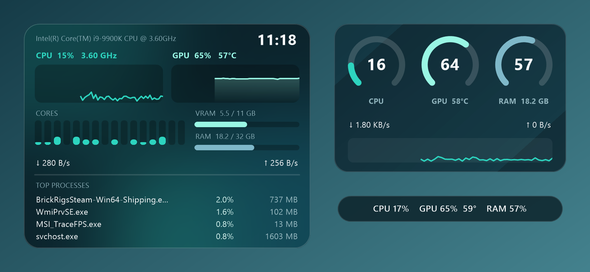

<div align="center">

# Euclase Monitor

**Системный монитор для Windows: трей, оверлей, скины в JSON.**
**System monitor for Windows: tray, overlay, JSON skins.**


[](https://github.com/SemyonZamiakin/EuclaseMonitor/actions/workflows/ci.yml)



<sub>Три встроенных скина на живых данных автора (i9-9900K, GTX 1080 Ti). / The three bundled skins with live data from the author's PC.</sub>

**[Русский](#русский)** | **[English](#english)**

</div>

---

# Русский

**CPU · GPU · память · сеть · самые активные программы** в настраиваемом оверлее, примерно за 5 МБ оперативной памяти.

## Зачем

Диспетчер задач тяжёлый, а классические мониторы железа перегружены, выглядят как из прошлого века, требуют плагинов или показывают рекламу.
Euclase Monitor это один `.exe` на ~400 КБ: без установщика, без .NET, без аккаунтов, без рекламы, без телеметрии.
Он показывает самое важное, там, где вам удобно, в любом виде, который можно описать текстовым файлом.

## Возможности

- **Живой оверлей** (скруглённый, полупрозрачный, «прозрачный для мыши») или окно, которое можно перетащить. Горячая клавиша показать/скрыть: `Ctrl+Alt+F10`.
- **Метрики:** CPU (общая и по ядрам), частота, память, видеокарта NVIDIA (нагрузка, температура, частоты, видеопамять, мощность, вентилятор), скорость сети, диски, самые активные программы, время. [Полный список](docs/METRICS.md).
- **Скины, которые правятся в Блокноте:** фон (цвет, градиент, **ваша собственная картинка**), шрифты, цвета, расположение, кольца, полосы, графики, столбики по ядрам, условия («показывать только когда видеокарта загружена»). **Сохранили файл, и изменения видны сразу.** Сломанный файл не ломает оверлей.
- **[Руководство по кастомизации](docs/CUSTOMIZE.ru.md):** пошаговый туториал, все примеры в нём проверяются автоматически.
- **Экспорт метрик** (по умолчанию выключен) в виде JSON по локальному HTTP, чтобы **ESP32 / SPI-дисплей**, скрипт или другая панель показывали данные вашего ПК. [Подробнее](docs/EXPORT.md).
- Меню в трее: смена скинов, режим «клик сквозь», перезагрузка, **«Customize this skin...»** (создаёт вашу копию скина и открывает её), автозапуск с Windows.
- Открытый код, лицензия MIT.

## Быстрый старт

1. Скачайте `EuclaseMonitor-<версия>.zip` в разделе [Releases](../../releases) и распакуйте куда угодно.
2. Запустите `EuclaseMonitor.exe`. Оверлей появится в правом верхнем углу, а в трее будет значок с меню.
3. Трей → **Skins** (скины): `glass`, `minimal` или `aurora`. Трей → **Customize this skin...**, чтобы сделать свой.

Windows может предупредить о неизвестном издателе: exe пока не подписан цифровой подписью. Нажмите *Подробнее → Выполнить в любом случае*,
сверьте SHA-256 со страницей релиза или соберите программу сами (см. ниже).

## Сделайте под себя

```jsonc
// my-skin/skin.json: весь оверлей это один этот файл
{
  "name": "Mine",
  "window": { "width": 220, "height": 70, "anchor": "top-left", "margin": [20, 20] },
  "background": { "image": "wallpaper.jpg", "imageOpacity": 0.5, "color": "#0a1f27", "radius": 16 },
  "widgets": [
    { "type": "text", "x": 14, "y": 10, "text": "CPU {cpu.load:0}%   GPU {gpu.temp:0}°C", "color": "#ffffff" },
    { "type": "bar",  "x": 14, "y": 42, "w": 192, "h": 8, "radius": 4, "value": "cpu.load", "color": "#2dd4bf",
      "colors": [ { "above": 90, "color": "#ff5d6c" } ] }
  ]
}
```

Фон меняется заменой одной картинки или одного цвета. Остальное (позиции, шрифты, какие числа показывать, когда они появляются)
настраивается так же просто. Смотрите **[docs/CUSTOMIZE.ru.md](docs/CUSTOMIZE.ru.md)**.

## Сколько занимает

Замерено на ПК автора (Windows 11, i9-9900K 16 потоков, 4K, GTX 1080 Ti), настоящий exe, обновление раз в секунду,
после 45 секунд работы (`tools/measure.ps1` воспроизводит замер):

| Скин | Рабочий набор | Приватный рабочий набор (колонка «Память» в Диспетчере задач) | Процессор |
|---|---|---|---|
| `glass` | 5,2 МБ | 2,2 МБ | 1,2% одного ядра (0,08% всего процессора) |
| `aurora` (картинка, графики, 43 виджета) | 7,7 МБ | 3,2 МБ | 1,35% одного ядра |

Сам exe весит 404 КБ. Он резервирует около 18 МБ адресного пространства (в основном не занятого физически), это то, что показывает «Private bytes».
Пока оверлей скрыт, программа опрашивает данные раз в 3 секунды и возвращает память системе.

## Честные ограничения (версия 0.1)

- **Температуры процессора нет.** В Windows нет пользовательского API для неё на большинстве ПК, нужен драйвер ядра (например, PawnIO). Это в планах как опциональная функция, пока метрика `cpu.temp` равна `n/a`.
- **Метрики видеокарты только для NVIDIA** (через NVML из драйвера). AMD и Intel пока не поддерживаются.
- `cpu.clock` это то, что отдаёт Windows, часто базовая частота, а не текущая с разгоном.
- Оверлей виден поверх игр в оконном и безрамочном режимах, но **не поверх игр в эксклюзивном полноэкранном режиме**.
- У экспорта метрик нет пароля: держите его на `localhost`, пока не доверяете своей сети. В сетевом режиме список программ не отправляется никогда.
- Проверено на одном ПК (Windows 11, NVIDIA). Отчёты с других конфигураций очень приветствуются.

## Сборка

Нужны Windows и [MSYS2](https://www.msys2.org) с `g++` для mingw64 (`pacman -S mingw-w64-x86_64-gcc`). Больше ничего.

```powershell
./build.ps1          # собирает build\EuclaseMonitor.exe и запускает все тесты
./package.ps1        # дополнительно делает dist\EuclaseMonitor-<версия>.zip
```

Подробнее: [архитектура и тесты](docs/ARCHITECTURE.md) (на английском).

## Лицензия

MIT, см. [LICENSE](LICENSE). Участие: [CONTRIBUTING.md](CONTRIBUTING.md). Безопасность: [SECURITY.md](SECURITY.md).

---

# English

**CPU · GPU · RAM · network · top processes** in a skinnable overlay, for about 5 MB of memory.

## Why

Task Manager is heavy, and the classic hardware monitors are cluttered, ugly, need plugins, or never stop nagging.
Euclase Monitor is one ~400 KB `.exe`: no installer, no .NET, no accounts, no ads, no telemetry.
It shows what matters, where you want it, in any look you can describe in a text file.

## Features

- **Live overlay** (rounded, translucent, click-through) or a draggable window. Hotkey to show/hide (`Ctrl+Alt+F10`).
- **Metrics:** CPU total and per core, clock, RAM, GPU load / temperature / clocks / VRAM / power / fan (NVIDIA), network speed, disks, busiest programs, time. [Full list](docs/METRICS.md).
- **Skins you can edit in Notepad:** backgrounds (colour, gradient, **your own picture**), fonts, colours, layout, rings, bars, graphs, per-core bars, conditions ("show only when the GPU is busy"). **Saved changes appear instantly**, a broken file never breaks the overlay.
- **[The customization guide](docs/CUSTOMIZE.md)** (also [in Russian](docs/CUSTOMIZE.ru.md)): a step-by-step tutorial where every example is tested automatically.
- **Metrics export** (off by default) as JSON over local HTTP, so an **ESP32 / SPI display**, a script or another panel can show your PC's numbers. [Details](docs/EXPORT.md).
- Tray menu: switch skins, click-through on/off, reload, **"Customize this skin..."** (makes your own copy and opens it), start with Windows.
- Open source, MIT.

## Get started

1. Download `EuclaseMonitor-<version>.zip` from [Releases](../../releases) and unzip anywhere.
2. Run `EuclaseMonitor.exe`. The overlay appears in the top-right corner; the tray icon has the menu.
3. Tray → **Skins** to pick `glass`, `minimal` or `aurora`. Tray → **Customize this skin...** to make it yours.

Windows may warn about an unknown publisher: the exe is not code-signed yet. Click *More info → Run anyway*,
check the SHA-256 on the release page, or build it yourself (below).

## Make it yours

```jsonc
// my-skin/skin.json: the whole overlay is this file
{
  "name": "Mine",
  "window": { "width": 220, "height": 70, "anchor": "top-left", "margin": [20, 20] },
  "background": { "image": "wallpaper.jpg", "imageOpacity": 0.5, "color": "#0a1f27", "radius": 16 },
  "widgets": [
    { "type": "text", "x": 14, "y": 10, "text": "CPU {cpu.load:0}%   GPU {gpu.temp:0}°C", "color": "#ffffff" },
    { "type": "bar",  "x": 14, "y": 42, "w": 192, "h": 8, "radius": 4, "value": "cpu.load", "color": "#2dd4bf",
      "colors": [ { "above": 90, "color": "#ff5d6c" } ] }
  ]
}
```

Change the background by swapping one picture or one colour. Everything else (positions, fonts, which numbers, when
things appear) is just as easy: see **[docs/CUSTOMIZE.md](docs/CUSTOMIZE.md)**.

## Footprint

Measured on the author's PC (Windows 11, i9-9900K 16 threads, 4K, GTX 1080 Ti), real exe, refresh once per second,
after 45 seconds of running (`tools/measure.ps1` reproduces it):

| Skin | Working set | Private working set (Task Manager "Memory") | CPU use |
|---|---|---|---|
| `glass` | 5.2 MB | 2.2 MB | 1.2% of one core (0.08% of the whole CPU) |
| `aurora` (picture, graphs, 43 widgets) | 7.7 MB | 3.2 MB | 1.35% of one core |

The exe is 404 KB. It reserves about 18 MB of address space (committed, mostly not resident), which is what "Private bytes" shows.
While the overlay is hidden it samples every 3 s and hands its memory back to Windows.

## Honest limits (v0.1)

- **CPU temperature is not shown.** Windows has no user-mode API for it on most PCs; reading it needs a kernel driver (e.g. PawnIO). It is on the roadmap as an opt-in; the metric `cpu.temp` is `n/a` for now.
- **GPU metrics: NVIDIA only** (through the driver's NVML). AMD / Intel GPUs: not yet.
- `cpu.clock` is what Windows reports, often the base clock rather than the live boost clock.
- The overlay shows over windowed and borderless games, **not over exclusive-fullscreen** games.
- The metrics export has no password: keep it on `localhost` unless you trust your network. In LAN mode the program list is never sent.
- Tested on one machine (Windows 11, NVIDIA). Reports from other setups are very welcome.

## Build

Requires Windows and [MSYS2](https://www.msys2.org) mingw64 `g++` (`pacman -S mingw-w64-x86_64-gcc`). Nothing else.

```powershell
./build.ps1          # builds build\EuclaseMonitor.exe and runs all unit tests
./package.ps1        # also makes dist\EuclaseMonitor-<version>.zip
```

More: [Architecture and tests](docs/ARCHITECTURE.md).

## License

MIT. See [LICENSE](LICENSE). Contributing: [CONTRIBUTING.md](CONTRIBUTING.md). Security: [SECURITY.md](SECURITY.md).
